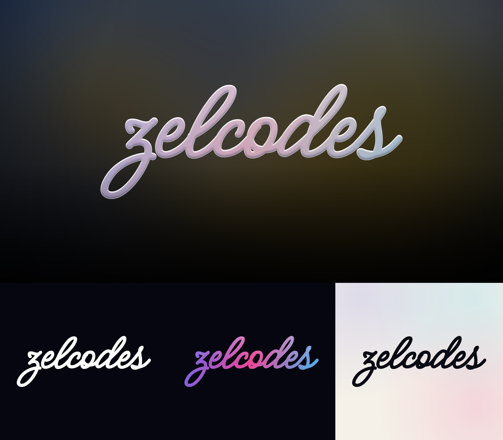

# Zelcodes — Logo

The logo is a **handwritten "zelcodes"**: one even, rounded pen line in a connected script, rendered in **liquid glass**
(frosted body, bright top highlight, light rim, soft shadow). Construction and rules: `graphicdesigner.md` §5.

## `static-transparent/` (PNG, transparent, 2400 px wide)

| File | Use |
|---|---|
| `zelcodes-logo-glass.png` | **Default.** Dark or colourful backgrounds, video, covers |
| `zelcodes-logo-white.png` | Photos and busy backgrounds |
| `zelcodes-logo-gradient.png` | Brand gradient (indigo → pink → sky) on dark |
| `zelcodes-logo-ink.png` | Light backgrounds, documents, print |

The glass logo needs something behind it; on white or very light backgrounds use the ink version.

## `with-background/`

| File | Use |
|---|---|
| `zelcodes-logo-glass-on-dark-16x9.png` | Hero image: glass logo on a dark, out-of-focus background (3840×2160) |

## `social/` (1:1)

| File | Use |
|---|---|
| `zelcodes-profile-dark-1080.png` | **Default avatar**: glass logo on the dark blurred background |
| `zelcodes-profile-light-1080.png` | Ink logo on off-white, for light-themed platforms |
| `zelcodes-profile-gradient-1080.png` | White logo on the brand gradient |
| `*-400.png` | Same, pre-sized for small avatars |
| `zelcodes-wordmark-square-{dark,light}-1080.png` | Square tiles that are not circle-cropped |

Every avatar keeps the logo inside the circular crop that Instagram, X, YouTube and GitHub apply.

## `font/`

`MeowScript-Regular.ttf` (SIL Open Font License, `MeowScript-OFL.txt`). The logo is this font thickened by 9 % of the
x-height with round joins — don't use the font at its native weight as the logo.

## `legacy-liquid-orbit/`

The previous logo (the `zelc◉des` lockup with the Liquid Orbit orb), kept for reference only. Don't use it in new work.
